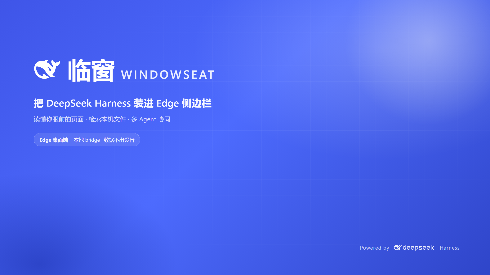
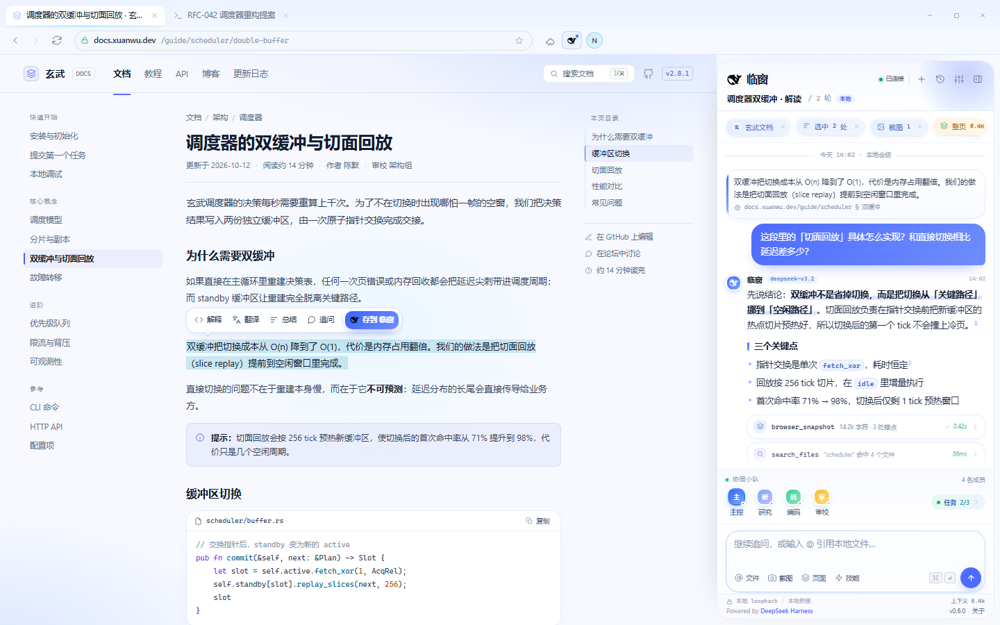
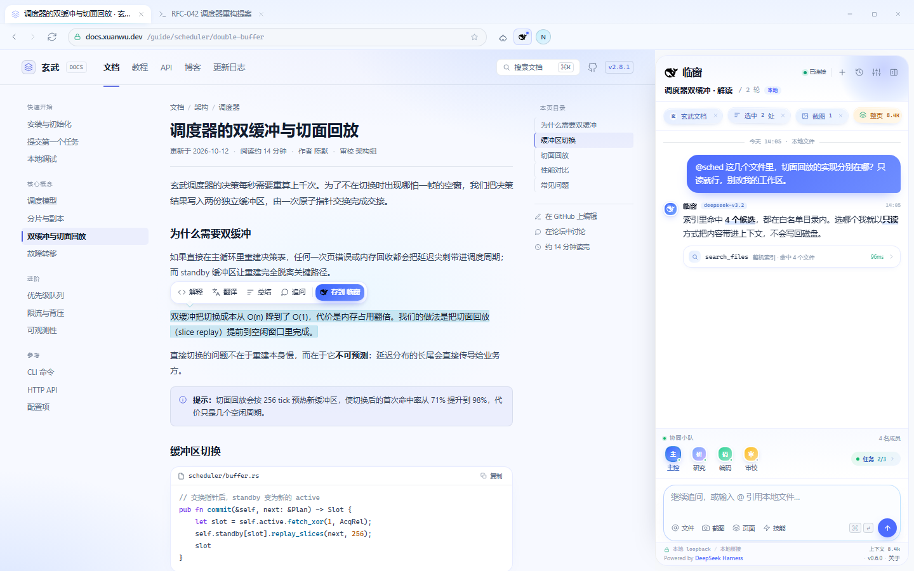
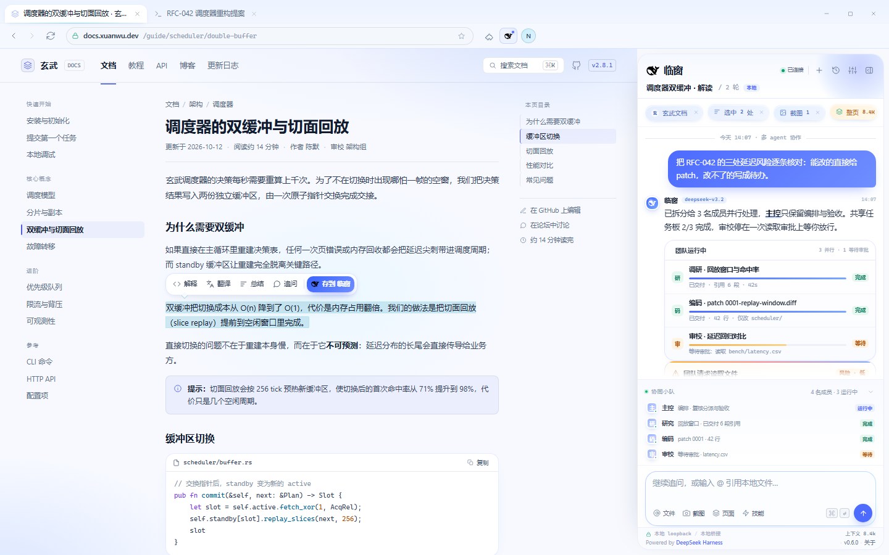
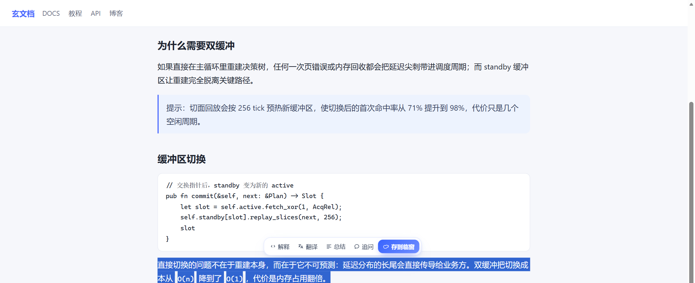
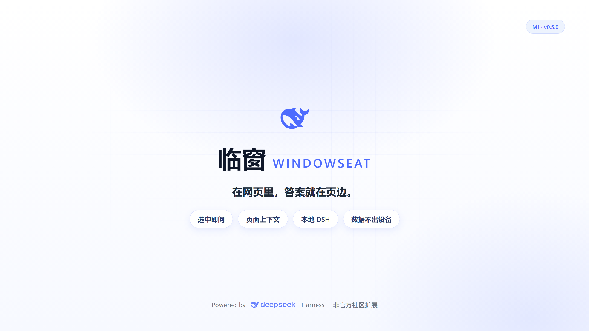

# 临窗 Windowseat

**把本机 [DeepSeek Harness](https://github.com/deepseek-ai/deepseek-harness) 装进 Microsoft Edge 侧边栏。**
选中即问、带着页面上下文回答、能查本机文件、能截图问、能派给多 Agent 小队。

`MV3 扩展` · `仅本机 loopback` · `无远程代码` · `Windows + Edge`

> **非官方社区扩展**：本项目与 DeepSeek 官方无关；DeepSeek 名称与鲸鱼标志版权归 DeepSeek 所有，仅用于说明「配合本机 DeepSeek Harness 使用」。



## 为什么做它

看网页时想追问一句，要复制粘贴到另一个窗口；想让 AI 参考自己电脑里的资料，得先把文件传到云上。临窗把这两件事合在一起：浏览器侧边栏里常驻一个「本机 DSH 的入口」。

- **选中即问**：网页划词出现浮条，点「解释 / 翻译 / 总结 / 追问」，内容自动带进侧栏。
- **页面上下文**：标题、URL、选中文字、正文摘录随问题一起交给本机 DSH，回答可引用回跳。
- **本机推理**：走你已登录的 DSH（`deepseek-account` / `deepseek-flash`），无需另配 API Key。
- **@ 本地文件**：白名单目录内只读检索，引用文件正文回答。
- **截图提问**：截当前页面，直接问界面里的东西。
- **协同小队**：只读显示 DSH Agent Team 的成员与共享任务。
- **本地优先**：扩展只和 `127.0.0.1` 上的本机桥通信，无自有云端、无遥测、无远程代码。

| 页面与回答 | 本地文件 |
|---|---|
|  |  |
| **协同小队** | **宣传片** |
|  | [▶ 1 分 45 秒演示](docs/windowseat-promo-1080p.mp4) |



> 在网页里，答案就在页边。



## 架构

```text
┌────────────────────┐   HTTP / SSE    ┌──────────────────────────┐
│ Edge 扩展 (MV3)     │ ◀────────────▶ │ DSH 宿主插件（本机桥）    │
│ side panel / 划词   │  127.0.0.1     │ 34281→34283 / bridge      │
│ background / 截图   │  仅本机回环     │ 接 sessionController      │
└────────────────────┘                 └──────────────────────────┘
                                              │
                                     本机 DeepSeek Harness
```

- `extension/` — MV3 扩展：侧边栏 UI、划词浮条（Shadow DOM）、端口探测、截图。
- `index.js` + `lib/` — DSH 宿主插件：自起 loopback HTTP/SSE 服务；接 DSH 会话、文件检索、历史会话、协同小队投影。
- `CONTRACT.md` — 扩展 ↔ 桥的接口契约（端点、SSE 帧、错误码、安全门禁）。
- `scripts/` — 安装/演示/隐私检查脚本；`docs/` — 安装与演示文档。

## 快速开始

前置：**Windows** + **Microsoft Edge** + 已安装并运行的 **DeepSeek Harness**（desktop profile）。

```bash
git clone <仓库地址> windowseat
cd windowseat
node scripts/dev-install.mjs desktop     # 把本机桥装进 DSH desktop profile（可用 DSH_BIN 指定 dsh 路径）
```

再到 `edge://extensions` 打开「开发人员模式」→「加载解压缩的扩展」→ 选择 `extension/` 目录。
默认索引 `%USERPROFILE%\Documents`（可在侧栏设置里增删白名单；系统与凭据目录不允许加入）。

> Edge 稳定版会把「开发者模式加载」的扩展标记为 `DISABLE_UNSUPPORTED_DEVELOPER_EXTENSION`，并可能要求重启浏览器后重新启用。`node scripts/start-demo.mjs` 会处理这个差异，用于本地演示（需要 Node ≥ 22）。

详细步骤与常见坑见 [docs/install.md](docs/install.md)，演示路径见 [docs/demo.md](docs/demo.md)。

## 隐私与安全

- **网络**：扩展只访问 `http://127.0.0.1:34281~34283`；桥只绑定回环地址，校验 `Host` 与 `Origin` 白名单（只有钉了 key 的本扩展来源）。
- **内容**：页面内容、本地文件、截图只在本机链路「扩展 → 本机桥 → 本机 DSH」里流转；扩展不向自有服务器上传，会话标题与最近面板消息只缓存在本机浏览器扩展存储（可在面板清空）。是否再发往云端，由你的 DSH 模型配置决定。
- **文件**：只读白名单，白名单外拒绝；系统目录与凭据目录（`Windows`、`AppData`、`.ssh` 等）不允许加入；不写盘。
- **权限**：MV3 最小权限，无远程代码，无 `eval`；扩展 ID 通过 manifest `key` 固定。
- 威胁模型与报告方式见 [SECURITY.md](SECURITY.md)，数据清单见 [PRIVACY.md](PRIVACY.md)。

发现安全问题请通过 GitHub Security Advisory 私下报告，不要公开 issue。

## 功能状态

- ✅ **M0**：真实 Edge + 真实 DSH 端到端跑通（划词 → 侧栏 → 流式回答 → 出处引用）。
- ✅ **M1（v0.6.0）**：@ 本地文件、历史会话与搜索、页面上下文刷新、断线重连、截图提问、协同小队只读 dock、设置（思考强度 / 白名单 / 快捷键 / 版本）、Markdown 表格与代码块渲染。
- 🚧 **下一步**：开发者体验与深色模式、快捷键自定义、Edge Add-ons 上架材料。

变更记录见 [CHANGELOG.md](CHANGELOG.md)。

## 开发

```bash
node --check index.js               # 语法检查（其它 JS 同理）
node scripts/check-privacy.mjs      # 公开前隐私/凭据扫描（CI 会跑）
node scripts/start-demo.mjs         # 独立 Edge 演示窗口（Windows / Node ≥ 22）
```

## 许可

代码以 [MIT](LICENSE) 发布。`extension/assets/` 中的 DeepSeek 鲸鱼标志与文字标志版权归 DeepSeek 所有，仅用于说明配合关系，不代表官方背书，详见 [NOTICE](NOTICE)。
